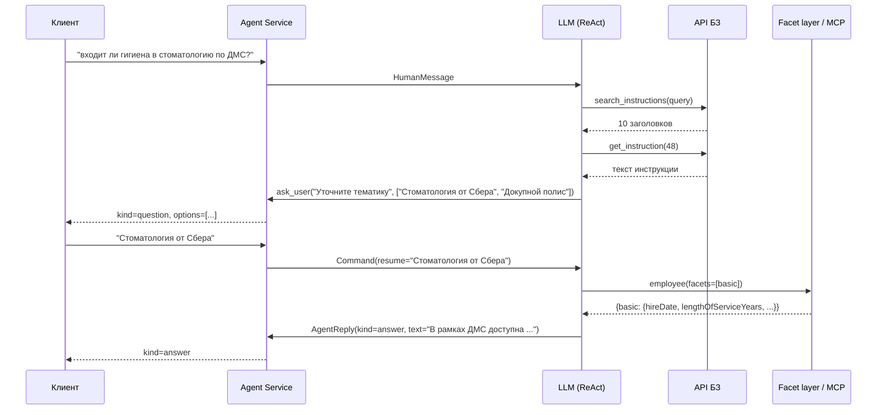

# Архитектура ReAct-агента по кадровым вопросам

Документ описывает архитектуру агента, который отвечает сотрудникам на кадровые вопросы по
базе знаний (БЗ) и данным о сотруднике из HR-сервисов. Код агента в этом репозитории не
реализован; здесь зафиксированы проектные решения, контракты и границы.

Входные материалы:

- `bz_cut.xlsx` — срез БЗ (112 инструкций).
- `mock_mcp_server/` — моковый MCP-сервер с 32 тулами HR-сервисов (контракт заморожен тестом).

## 1. Назначение и границы

Агент:

- понимает вопрос сотрудника и находит подходящую инструкцию в БЗ;
- при необходимости собирает данные о сотруднике (или его подчинённом) из HR-сервисов;
- в любой момент может задать пользователю вопрос, опционально с вариантами ответа;
- отвечает текстом либо предлагает создать заявку, возвращая группу (`group`) из инструкции;
- продолжает диалог после ответа: уточнения по той же инструкции, новые вопросы.

Агент не делает:

- не создаёт заявки (только возвращает `group`; кнопку и создание делает клиент);
- не реализует API БЗ и HR-API (использует их как внешние);
- не выполняет инструкции для операторов 1-й линии (`status_false`);
- не проверяет права на создание заявки (заявка предлагается только когда её предписывает
  инструкция).

## 2. Ключевые решения

| Вопрос | Решение | Почему |
|---|---|---|
| LLM | DeepSeek через OpenAI-совместимый API, native tool calling (`langchain-deepseek`) | Задано проектом |
| Каркас | LangChain `create_agent` поверх LangGraph | `interrupt()` для вопросов пользователю, checkpointer для состояния диалога, middleware для промпта и guardrails |
| Чьи данные доступны | Свои и подчинённых; id текущего пользователя приходит от вызывающей системы | Агент не спрашивает, кто пишет; чужие данные закрыты guard'ом |
| Инструкции `status_false` | Не показываются модели | Написаны для операторов (SAP GUI, «измени рабочую группу») |
| Заявка | Только по инструкции; `group` дословно из её текста | Прав агент не проверяет |
| Встраивание | HTTP-сервис, состояние диалога у агента (Postgres) | Клиент шлёт сообщение и получает ответ, вопрос или заявку |
| Поиск по БЗ | top-10 заголовков, затем полный текст одной инструкции по id | Поиск неточный, а десять полных текстов размывают внимание модели (п. 5.1) |
| Тулы данных | 6 сущностей с фасетами вместо ~40 тулов | Меньше схем в промпте, lazy-load полей, fan-out за один шаг (п. 5.3) |
| Фасетный слой | Адаптер внутри агента над существующими MCP-тулами | Контракт MCP заморожен |

## 3. Общая схема

```
Клиент (чат)  --HTTP-->  Agent Service (FastAPI)
                            |
                            |-- Turn router: новое сообщение | ответ на вопрос агента (resume)
                            |
                            |-- LangGraph agent (create_agent, ChatDeepSeek)
                            |     |-- middleware: dynamic prompt, context editing, reply validator
                            |     |-- tools (9):
                            |     |     search_instructions, get_instruction, ask_user,
                            |     |     employee, course, hr_request, learning_request,
                            |     |     onsite_activity, vacancy
                            |     |-- response_format: AgentReply (answer | ticket_offer)
                            |
                            |-- Facet layer: реестр фасет -> identity guard -> MCP-вызовы -> проекция
                            |-- Checkpointer (Postgres, шифрование), thread_id = session_id
                            |-- Adapters: KB API client, MultiServerMCPClient (HR MCP-серверы)
```

Один ход пользователя = один ReAct-цикл. Вопрос пользователю реализован как тул `ask_user`,
который вызывает `interrupt()`: граф останавливается, HTTP-ответ уходит клиенту с
`kind=question`, следующий запрос клиента возобновляет граф с ответом пользователя.

Пример хода (инструкция про стоматологию, строка 48 среза):



## 4. Контракт HTTP API агента

```
POST /sessions/{session_id}/messages
Content-Type: application/json

{ "employee_id": "1655480",
  "person_id": "9f219670-8655-4aab-a7b3-fdcf4e732ac6",   // опционально
  "message": "отпуск" }
```

```
200 OK
{ "kind": "question" | "answer" | "ticket_offer",
  "text": "...",
  "options": ["iOS", "Android"],                         // только для question, может отсутствовать
  "group": "ДМС Мое здоровье_МИП - экспертиза дмс",      // только для ticket_offer
  "trace_id": "..." }
```

- `session_id` — идентификатор диалога, он же `thread_id` checkpointer'а. Сессия живёт, пока
  живёт чат; у сессий есть TTL и фоновая очистка.
- `employee_id` приходит в каждом запросе от вызывающей системы; аутентификация — её зона.
- `ticket_offer` всегда содержит и `text` (сопроводительное сообщение из инструкции, например
  «Для корректировки необходимо завести заявку на специалиста…»), и `group`.
- Ошибка LLM или сети → `502` с `trace_id`; состояние thread'а не портится, так как checkpoint
  пишется после каждого шага графа.

## 5. Тулы

Модель видит девять тулов: два для БЗ, один для вопросов пользователю, шесть для данных.

### 5.1. Поиск по БЗ: двухступенчатый

`search_instructions(query: str) -> list[InstructionHeader]`

- Обёртка над API БЗ: запрашивает top-10 по близости `query` к колонке «Вопрос».
- Отбрасывает строки со `status_false`.
- Возвращает только заголовки: `id`, `question`, `type` (`RAG` / `API` / `API_HARD`),
  `topics` (три тематики), `score`. Это около 30 токенов на строку, около 300 на весь результат.

`get_instruction(id: int) -> Instruction`

- Полный текст одной инструкции плюс тип и тематики.
- Пишет `active_instruction_id` в состояние thread'а и добавляет `id` в `seen_instruction_ids`.

Почему не отдавать полные тексты сразу: инструкция занимает 300–2500 токенов, top-10 — это
10–20К токенов на один поиск, а поисков в диалоге несколько. Помимо цены и латентности, десять
условных инструкций рядом провоцируют смешивание веток (строки 214 и 239 среза похожи по
структуре). Двухступенчатый поиск стоит один дополнительный шаг ReAct, зато выбор
инструкции становится явным действием, а в контексте живёт одна активная инструкция.

Модель может открыть вторую инструкцию, если из первой стало ясно, что подходит соседняя,
но промпт запрещает открывать несколько «на всякий случай». Доля ходов с более чем одним
`get_instruction` — метрика качества заголовков (п. 10). Если заголовки окажутся
неинформативными, внутрь `search_instructions` добавляется реранк (кросс-энкодер по
вопросу и истории); интерфейс тула при этом не меняется.

### 5.2. Вопрос пользователю

`ask_user(question: str, options: list[str] | None = None) -> str`

- Вызывает `interrupt({"question": ..., "options": ...})` и возвращает текст ответа пользователя
  как результат тула.
- Используется для: уточнения общего вопроса («отпуск» → какой именно), выбора между близкими
  инструкциями (варианты строятся из различий их заголовков: устройство, программа, тип
  отпуска), вопросов из текста инструкции («уточни у сотрудника, записывался ли он в клинику
  с выбором даты»).
- Ограничение LangGraph: при возобновлении код тула до `interrupt()` выполняется повторно,
  поэтому тул содержит только вызов `interrupt` и ничего с побочными эффектами.
- Один ход = один вопрос. Если инструкция требует два вопроса подряд, это два хода.

### 5.3. Сущности с фасетами

Вместо ~40 тулов по одному на endpoint модель видит шесть тулов-сущностей. У каждой есть
параметр `facets: list[<EntityFacet>]` — какие группы полей подтянуть. Фасет соответствует
одному вызову бэкенда (иногда цепочке), модель запрашивает только нужные фасеты (lazy-load)
и все сразу за один шаг.

```
employee(facets: list[EmployeeFacet], for_employee_id: str | None = None) -> dict
course(facets: list[CourseFacet], name: str | None = None, item_id: str | None = None,
       for_employee_id: str | None = None) -> dict
hr_request(facets: list[HrRequestFacet], number: str) -> dict
learning_request(facets: list[LearningRequestFacet], request_id: str) -> dict
onsite_activity(facets: list[OnsiteActivityFacet], activity_id: str) -> dict
vacancy(facets: list[VacancyFacet], vac_num: int | None = None, publication_id: str | None = None,
        job_requisition_id: str | None = None, position_id: str | None = None) -> dict
```

Имена и описания фасет — на языке инструкций, а не бэкендов: модель выбирает фасет по фразе
«получи данные о стаже», а не по имени сегмента `J.BASIC`.

Маппинг фасет на тулы мокового MCP-сервера:

| Сущность | Фасет | MCP-тул(ы) | Что остаётся в проекции |
|---|---|---|---|
| employee | `basic` — стаж, дата приёма, статус, категория | `person_profile` (J.BASIC) | hireDate, lengthOfServiceYears/Month/Days, status, categoryPerson, probation* |
| | `position` — грейд, должность, подразделение | `person_profile` (J.POSITION) | grade, fullName, kostlName, funcBlock, positionId |
| | `contacts` — почта, телефоны | `person_profile` (J.CONTACTS.*) | адреса и номера |
| | `org_chain` — цепочка подразделений вверх | `org_structure_user_info` → `org_structure_vertex_position` | список вершин name/type |
| | `hrbp` — HR-бизнес-партнёр | `org_structure_hrbp_info` | имена, позиции |
| | `subordinates` — прямые подчинённые | `org_structure_subordinate` | имя, person_id |
| | `is_chief` — руководитель ли | `is_chief` | Chief, подразделения в подчинении |
| | `insurance` — страховая ДМС/НС, город, программа | `get_health_company_name` | dms.name, ns.name, city, programType, insuranceTypeDms |
| | `schedule` — график работы | `schedule_info` | вид графика |
| | `events` — кадровые мероприятия и отсутствия с кодами | `user_events_info` | текст вида, код вида, даты начала и окончания |
| | `absence_limits` — лимиты отпусков | `absence_limit` | вид отпуска, всего, использовано, остаток |
| | `requests` — заявки ЕАСУП за 45 дней | `user_request_info` | номер, статус, дата, код подтипа |
| | `sicklists` — больничные | `sicklist_info` | периоды |
| | `access_groups` — группы доступа | `authorization_groups` | identifier, description |
| | `assignments` — назначенные курсы | `assignment` | itemName, status, deadLine |
| | `learning_requests` — заявки на внешнее обучение | `learning_requests` | requestId, name, status |
| | `recruiter_role` — рекрутер ли | `recruiter` | флаг, группы |
| course | `catalog` — поиск по названию | `item_ids_by_course_names` | id, name, type, status |
| | `availability` — доступен ли сотруднику | `course_available` | personOpt |
| | `progress` — прогресс сотрудника | `course_progress` | complete, viewed, contentState |
| | `history` — история прохождения | `learning_history` | status, passed, completedAt |
| | `tags` | `item_tag` | список тегов |
| | `onsite_registrations` — регистрации на очные мероприятия | `onsite_activities_registrations` | activityId, status |
| | `assignment_requirements` — можно ли отменить назначение | `assignments_requirement` | selfCancel |
| hr_request | `status` — статус заявки ЕАСУП по номеру | `user_request_info_by_number` | TextStatus |
| learning_request | `info` | `learning_request_info` | request, report, history |
| onsite_activity | `info` | `onsite_activities_information` | startDate, endDate |
| vacancy | `job`, `publications`, `application`, `job_profile` | `job_info`, `publication_info`, `publication_info_by_job_requisition_id`, `job_application`, `job_profile` | как есть, минус служебные поля |

`get_id_mapper_person_id` — служебный тул: фасетный слой использует его для связки ключей,
модели он не показывается.

Поведение фасетного слоя (модуль `facets/`, детерминированный код без LLM):

- **Реестр.** `FacetSpec(name, description, mcp_tool, key_kind, project)`. Тул-сущность
  собирает enum фасет и свой docstring из реестра автоматически; новый фасет — одна запись.
- **Ключи.** Связка `employee_id ↔ person_id` резолвится один раз на сессию через
  `get_id_mapper_person_id` и кэшируется в состоянии. Цепочки (например, `org_chain`:
  позиция → вершины оргструктуры) выполняются внутри фасета. Модель не видит ни
  `person_id`, ни `position_id`.
- **Fan-out.** Все запрошенные фасеты выполняются параллельно; ответ —
  `{facet: data | {"error": "текст"}}`. Ошибка одного фасета не ломает остальные; на каждый
  MCP-вызов есть таймаут.
- **Проекция.** Убираются служебные поля (`__metadata`, `success`, `pagination`, `meta`,
  `totalElements` и т.п.). Даты приводятся к `YYYY-MM-DD` (инструкция 214 прямо требует
  сравнение дат в этом формате). Табельный номер — строка без ведущих нулей. Проекции
  маленькие и покрыты unit-тестами.
- **Пусто и ошибка.** Семантика бэкендов сохраняется: пустой `data` → пустой список или `null`
  с пометкой «данных нет», сущность не найдена → `{"error": "..."}` с текстом причины.

### 5.4. Финальный ответ

Финальный ответ — не тул, а структурированный вывод `response_format=AgentReply`:

```python
class AgentReply(BaseModel):
    kind: Literal["answer", "ticket_offer"]
    text: str
    group: str | None = None  # обязателен для ticket_offer
```

`kind=question` через `AgentReply` не выражается: вопрос возникает только через `ask_user`
(interrupt). Это гарантирует, что ход завершается ровно одним из трёх исходов.

## 6. Обработка хода (turn router)

1. Сервис читает состояние thread'а по `session_id`.
   - Есть незавершённый interrupt (агент ждал ответа на `ask_user`) →
     `agent.invoke(Command(resume=message), config)`.
   - Иначе → `agent.invoke({"messages": [HumanMessage(message)]}, config)`.
2. В runtime context передаются `employee_id`, `person_id` (если известен), `today`
   (инструкции сравнивают даты с текущей), `session_id`.
3. Результат:
   - `result.interrupts` непустой → ответ `kind=question` из payload interrupt'а;
   - иначе `structured_response: AgentReply` → `answer` или `ticket_offer`.
4. Пользователь может ответить на вопрос агента не по теме (новым вопросом). Текст всё равно
   попадает в результат тула `ask_user`; модель видит его и решает, продолжить ветку или
   искать заново. Отдельной логики не нужно.
5. После ответа диалог продолжается в том же thread'е. «А если у меня Android?» — модель
   продолжает по активной инструкции без нового поиска (правило промпта, п. 7).

## 7. Промпт-стратегия

Системный промпт собирается middleware `dynamic_prompt` из блоков.

**Роль и контекст.** HR-ассистент сотрудника банка. Сегодня `{today}`. Табельный номер
пользователя `{employee_id}`. Если в состоянии есть `active_instruction_id` — блок
«Активная инструкция №N: «вопрос»» (только заголовок; текст уже в истории как результат
`get_instruction`).

**Процедура хода.**

- Сообщение — продолжение активной инструкции (уточнение, «а если…», другой вариант ответа
  на заданный ранее вопрос) → продолжать по ней, поиск не повторять.
- Иначе → `search_instructions`. Если вопрос слишком общий («отпуск»), сначала `ask_user`.
- Выбор по заголовкам: один явно подходит → `get_instruction`; несколько близких →
  `ask_user` с вариантами из различий заголовков; ни один → честно сказать, что ответить не
  может. Не открывать больше одной инструкции без причины.

**Выполнение инструкции по типу.**

- `RAG` → ответить текстом инструкции; можно сократить до релевантной части, ссылки, телефоны
  и адреса сохранять дословно.
- `API` / `API_HARD` → идти по шагам по порядку. Данные брать только тулами-сущностями,
  запрашивая сразу все фасеты, нужные по инструкции. Условия («стаж ≥ 2 лет», «грейд ниже
  17», «статус Отклонен или Отозван», «код подтипа 0001») проверять по полученным данным.
  Цитаты вида «сообщи: «…»» и «строго как указано» — дословно.
- «Уточни у сотрудника», «предоставив список вариантов» → `ask_user`, варианты из инструкции.
- «Создай заявку на группу X» / «создай заявку на "X"» →
  `AgentReply(kind=ticket_offer, group=X дословно, text=сопроводительный текст из инструкции)`.

**Глоссарий «формулировка в инструкции → сущность.фасет».** Поддерживается вместе с БЗ:

| В инструкции | Фасет |
|---|---|
| стаж, непрерывный срок работы, дата приёма | `employee.basic` |
| грейд, разряд, должность, подразделение | `employee.position` |
| страховая компания, город сотрудника, программа ДМС | `employee.insurance` |
| кадровые мероприятия, отсутствия с кодом (0114, 0216, Z2) | `employee.events` |
| запросы или заявки сотрудника по фильтру, коды подтипов, статусы | `employee.requests` |
| статус запроса по номеру (8 цифр) | `hr_request.status` |
| лимиты отпуска, остаток дней | `employee.absence_limits` |
| больничные | `employee.sicklists` |
| является ли руководителем | `employee.is_chief` |
| подчинённые | `employee.subordinates` |

**Запреты.** Не выдумывать ссылки, телефоны, группы, сроки. Не отвечать вне инструкции. Один
вопрос за раз. Не спрашивать табельный номер. Если фасет вернул ошибку или пусто — сказать,
что данных нет, и продолжить по инструкции, если она это предусматривает.

## 8. Доступ к данным (identity guard)

Реализован в фасетном слое, общий для всех сущностей с параметром `for_employee_id`:

- `for_employee_id` пусто → подставляется id текущего пользователя из runtime context.
- Заполнено → `get_id_mapper_person_id` даёт `person_id`; он должен входить в множество
  подчинённых текущего пользователя (`org_structure_subordinate`, кэш на сессию). Иначе тул
  возвращает `{"error": "нет доступа к данным этого сотрудника"}`, и модель сообщает это
  пользователю.
- Подчинённый может быть назван по имени: модель запрашивает `employee(facets=[subordinates])`,
  сопоставляет имя и передаёт табельный номер.
- `hr_request`, `learning_request`, `onsite_activity`, `vacancy` ключуются не по сотруднику;
  ограничение «свой или подчинённый» к ним неприменимо. Это допущение v1.

## 9. Состояние и контекст

Состояние thread'а:

| Поле | Назначение |
|---|---|
| `messages` | вся ReAct-история, включая вызовы тулов |
| `active_instruction_id` | какую инструкцию сейчас выполняем; попадает в промпт |
| `seen_instruction_ids` | все открытые в сессии инструкции; нужны валидатору `group` |
| `identity` | кэш `employee_id ↔ person_id` и множество подчинённых |

Управление длиной контекста:

- `ContextEditingMiddleware(ClearToolUsesEdit)` очищает старые результаты тулов-сущностей
  (объёмные JSON), исключая `search_instructions`, `get_instruction`, `ask_user`.
- `SummarizationMiddleware` сворачивает историю старше порога. Активная инструкция при этом
  восстанавливается повторным `get_instruction` — модель видит её id в промпте.
- `recursion_limit` около 25 шагов на ход. При превышении — ответ «не удалось обработать
  вопрос» и запись в лог.

Хранение: `AsyncPostgresSaver` с `EncryptedSerializer`, потому что в истории персональные
данные. Сессии имеют TTL, устаревшие thread'ы удаляются фоновой задачей.

## 10. Guardrails и наблюдаемость

Валидация результата (middleware `after_model`):

- `ticket_offer.group` обязан встречаться подстрокой в тексте одной из инструкций из
  `seen_instruction_ids`. Иначе модели возвращается замечание и даётся одна попытка; затем
  ответ деградирует в `answer` без заявки, инцидент логируется.
- `question` без текста или с более чем шестью вариантами отклоняется так же.
- Ошибки тулов (`ToolError`, таймауты) попадают в `ToolMessage` текстом, не исключением.

Наблюдаемость (LangSmith или OpenTelemetry):

- на каждый ход: вопрос, id заголовков из поиска, выбранная инструкция, вызовы сущностей с
  фасетами (без тел ответов с персональными данными), итоговый `kind`, `group`, `trace_id`;
- метрики: доля `question` / `answer` / `ticket_offer`, шагов на ход, латентность, ошибки
  фасет, срабатывания guardrails, доля ходов с более чем одним `get_instruction`.

## 11. Тестирование

**Unit (без LLM):** identity guard (свой / подчинённый / чужой), фильтр `status_false`,
валидатор `group`, turn router (resume против нового сообщения), маппинг interrupt →
`question`, проекции фасет (служебные поля убраны, даты нормализованы), fan-out с ошибкой
одного фасета.

**Сценарные тесты (с LLM, `@pytest.mark.llm`):** YAML-сценарии против мокового MCP-сервера
(in-process через `fastmcp.Client`) и заглушки БЗ над `bz_cut.xlsx` (BM25 или эмбеддинги по
колонке «Вопрос»).

```yaml
id: dentistry_hygiene_purchasable   # строка 48, scenario_1_5
employee_id: "1655480"
steps:
  - user: "входит ли гигиена в стоматологию по ДМС?"
    expect: {kind: question, options_count: 2}
  - user: "докупной полис"
    expect: {kind: ticket_offer, group: "ДМС Мое здоровье_МИП - экспертиза дмс"}
```

Обязательный набор сценариев:

- строка 48 — три ветки: заявка, стаж ≥ 2 лет, стаж < 2 лет;
- строка 214 — номер заявки есть в тексте / номера нет;
- строка 238 — грейд ниже 17 / 17 и выше;
- строка 63 — город → вопрос пользователю → две ветки;
- RAG-строка 99 — ответ текстом без тулов данных;
- follow-up «а если…» после ответа без повторного поиска;
- вопрос про чужого сотрудника → отказ guard'а;
- слишком общий вопрос «отпуск» → уточнение;
- два близких заголовка → `ask_user` с вариантами.

Проверка `expect` детерминированная по полям (`kind`, `group`, `options_count`,
`text_contains`, опционально `tools_called`). Качество формулировок оценивается отдельным
LLM-judge в eval-прогоне, не в CI.

## 12. Структура пакета

```
hr_agent/
  api/        FastAPI-приложение, pydantic-схемы запроса и ответа, turn router
  agent/      сборка create_agent, промпт-блоки, глоссарий, AgentReply, middleware
  tools/      search_instructions, get_instruction, ask_user, тулы-сущности (из реестра фасет)
  facets/     реестр FacetSpec, проекции, identity guard, fan-out, MCP-клиент
  kb/         протокол клиента БЗ + заглушка над xlsx для тестов
  config.py   модель, URL БЗ и MCP, N=10, лимиты, DSN Postgres
tests/
  unit/…, scenarios/*.yaml, conftest.py (in-process mock MCP)
```

Зависимости (согласовать перед реализацией): `langchain`, `langgraph`, `langchain-deepseek`,
`langchain-mcp-adapters`, `langgraph-checkpoint-postgres`, `fastapi`.

## 13. Риски и что отложено

- **Инструкции написаны для людей.** Шаг «получи данные о стаже» модель должна сопоставить с
  фасетом. Глоссарий и описания фасет снижают риск; новые инструкции требуют пополнения
  глоссария.
- **Длинные условные инструкции.** DeepSeek может путать ветки (строка 214). Сценарные тесты
  именно на такие строки; одна активная инструкция в контексте снижает риск.
- **Неинформативные заголовки.** Модель может открыть не ту инструкцию. Метрика «более
  одного `get_instruction` за ход» покажет масштаб; усиление — реранк внутри поиска.
- **Реальный API БЗ.** Порог score и N могут отличаться от предположений; вынесены в конфиг.
- **Дублирование знания о бэкендах.** Описания есть и в MCP-тулах, и в реестре фасет. Принято
  осознанно: контракт MCP заморожен. При переделке MCP реестр переносится на сервер, агент
  подключает тулы-сущности как есть.
- **Один interrupt на ход.** Два вопроса подряд — два хода. Для клиента это прозрачно.
